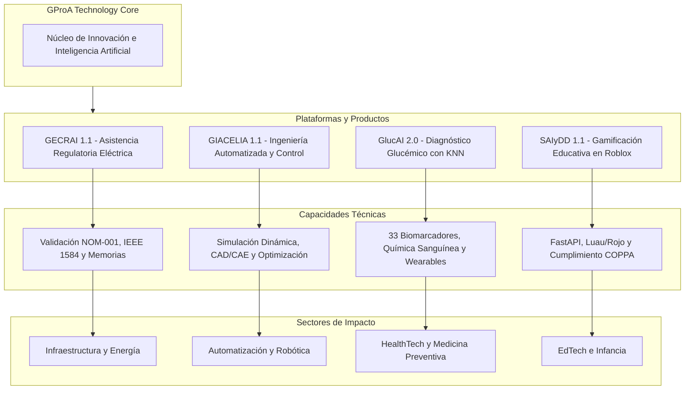
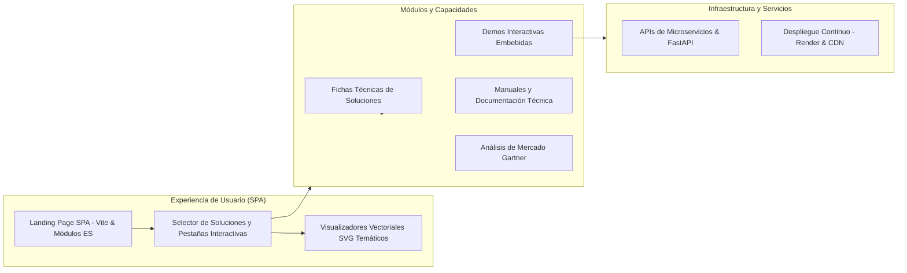

# GProA Technology S. de R.L. de C.V.

> **Transformando ideas en realidad digital** — Innovación en desarrollo de software, inteligencia artificial aplicada, salud predictiva y tecnologías inmersivas.

[](https://gproatechnology.com)
[](https://gproa-paginaweb.onrender.com)
[](LICENSE)
[](https://maps.google.com)

---

## 🌟 Carta de Presentación y Cometido

**GProA Technology S. de R.L. de C.V.** es una firma tecnológica mexicana de vanguardia dedicada a la investigación, diseño e implementación de soluciones de software de alto impacto impulsadas por **Inteligencia Artificial**, automatización de procesos complejos y analítica predictiva.

### Nuestro Propósito
Superar la brecha entre la teoría tecnológica y la aplicación industrial e institucional, entregando plataformas digitales robustas, intuitivas y rigurosamente validadas que aceleran la toma de decisiones, protegen la integridad operativa y elevan la calidad de vida de las personas.

### Pilares Estratégicos de Innovación

1. **Ingeniería Regulatoria y Asistencia Eléctrica:** Automatización de memorias de cálculo y dictamen normativo en estricto cumplimiento con estándares oficiales e internacionales.
2. **Sistemas de Control y CAD/CAE:** Plataformas de diseño y simulación en tiempo real que optimizan flujos de ingeniería industrial mediante IA.
3. **HealthTech y Diagnóstico Predictivo:** Modelos de aprendizaje automático para el análisis de biomarcadores bioquímicos y prevención temprana de trastornos metabólicos.
4. **EdTech y Entornos Virtuales Interactivos:** Experiencias formativas gamificadas y adaptativas en entornos 3D multiusuario, diseñadas bajo estándares rigurosos de protección infantil.

---

## 🗺️ Ecosistema Tecnológico de Soluciones

El siguiente diagrama ilustra la arquitectura de valor de GProA, conectando nuestro núcleo tecnológico con las cuatro plataformas bandera y sus sectores de impacto:



---

## 💼 Portafolio de Soluciones Estratégicas

### 1. [GECRAI 1.1](https://github.com/gproatechnology/GProA_GECRAI.git) — Generador de Consultas Regulatorias con Asistencia Inteligente
Asistente virtual de ingeniería eléctrica con procesamiento de lenguaje natural avanzado enfocado en normatividad técnica:
- **Validación Normativa:** Cumplimiento automatizado de la **NOM-001-SEDE-2012**.
- **Cálculo de Arc Flash:** Determinación de niveles de energía incidente bajo estándar **IEEE 1584**.
- **Ingeniería Automática:** Generación instantánea de memorias de cálculo e integración con AutoCAD y Revit.

### 2. [GIACELIA 1.1](https://github.com/gproatechnology/GProA_GIACELIA.git) — Plataforma de Ingeniería Automatizada
Suite integral de diseño asistido y simulación dinámica para sistemas de control industrial:
- **Simulación Dinámica:** Modelado de respuesta transitoria y lazos de control cerrados en tiempo real.
- **Optimización con IA:** Algoritmos heurísticos y de optimización continua para diseño de ingeniería.
- **Interoperabilidad CAD/CAE:** Carga, procesamiento y exportación de esquemas técnicos de instrumentación.

### 3. [GlucAI 2.0](https://gproa-glucai.onrender.com) — Sistema de Diagnóstico Glucémico Predictivo
Plataforma médica de soporte a la decisión clínica para análisis del metabolismo glucídico:
- **Motor KNN Multivariable:** Clasificación de perfiles glucémicos (Normal, Prediabetes, Riesgo) evaluando **33 biomarcadores de química sanguínea**.
- **Prevención de Hipoglucemia / Hiperglucemia:** Alertas tempranas con integración de telemetría de dispositivos vestibles (*wearables*).
- **Explicabilidad Clínica:** Generación de reportes automáticos exportables en formatos CSV y JSON para auditoría médica.

### 4. [SAIyDD 1.1](https://github.com/gproatechnology/GProA_SAIyDD) — Generador de Experiencias Educativas en Roblox Studio
Ecosistema de creación procedural y despliegue de experiencias lúdico-educativas para niños de 4 a 8 años:
- **Generación 3D Procedural:** Creación dinámica de mundos interactivos y bloques modulares en Roblox Studio mediante integración con **Rojo (Luau)**.
- **Infraestructura Cloud Segura:** Backend en **FastAPI** con autenticación JWT, rate limiting y registro de sesiones de aprendizaje.
- **Enfoque Kid-Safe:** Moderación automatizada y riguroso cumplimiento de normativas de privacidad infantil (**COPPA**).

---

## 🏛️ Arquitectura del Portal y Plataforma Web

El portal web de GProA Technology funciona como la vitrina tecnológica unificada, incorporando demostraciones funcionales, visualizaciones vectoriales interactivas y análisis de mercado.



---

## 📁 Estructura del Repositorio

```
Pagina_web/
├── index.html                   # Entry point de la aplicación web principal
├── vite.config.js              # Configuración de compilación y empaquetado Vite
├── package.json                # Dependencias y scripts de construcción
├── start-dev.ps1               # Script de entorno de desarrollo local
├── assets/
│   ├── images/                 # Logotipos institucionales, fotos ejecutivas y diagramas SVG
│   │   ├── gecrai-diagram.svg   # Identidad visual temática GECRAI
│   │   ├── giacelia-diagram.svg # Identidad visual temática GIACELIA
│   │   ├── glucai-diagram.svg   # Identidad visual temática GlucAI
│   │   └── saiydd-diagram.svg   # Identidad visual temática SAIyDD
│   └── video/                  # Material multimedia de fondo
├── src/
│   ├── css/
│   │   ├── styles.css          # Estilos globales y tokens de diseño
│   │   └── modules/            # Módulos CSS (base, hero, proyectos, servicios, etc.)
│   ├── data/
│   │   ├── proyectos.js        # Modelo de datos centralizado del portafolio
│   │   ├── noticias.js         # Feed de divulgación tecnológica e IA
│   │   └── gartner.js          # Datos comparativos de métricas de mercado
│   └── js/
│       ├── main.js             # Punto de entrada JavaScript y orquestador
│       ├── modules/            # Módulos funcionales (project-tabs, navigation, etc.)
│       └── utils/              # Utilidades de accesibilidad y soporte
└── proyectos/                  # Entornos demostrativos y documentación de productos
    ├── gecrai/                 # Demo y manual interactivo de GECRAI
    ├── giacelia/               # Demo y manual interactivo de GIACELIA
    ├── glucai/                 # Demo y manual interactivo de GlucAI
    └── saiydd/                 # Demo y manual interactivo de SAIyDD
```

---

## 👥 Gobierno y Liderazgo Ejecutivo

| Liderazgo | Cargo | Especialidad | Contacto |
|:---|:---|:---|:---|
| **Juan Abdel Lugo Trejo** | Socio Fundador & Chief Executive Officer (CEO) | Dirección técnica, visión estratégica, tecnologías emergentes, automatización y control electrónico. | [trejulu@gproatechnology.com](mailto:trejulu@gproatechnology.com) |
| **Israel Aldair Reséndiz Gálvez** | Socio Administrativo & Chief Operating Officer (COO) | Operaciones globales, representación legal, gestión financiera, alianzas institucionales y normatividad. | [admin@gproatechnology.com](mailto:admin@gproatechnology.com) |

---

## 📬 Contacto y Canales Oficiales

Para alianzas comerciales, licenciamiento de tecnología, consultoría especializada o solicitudes institucionales:

- **Portal Oficial:** [https://gproatechnology.com](https://gproatechnology.com)
- **Correo Institucional:** [admin@gproatechnology.com](mailto:admin@gproatechnology.com)
- **Teléfono / WhatsApp Empresarial:** +52 1 468 120 8570 / +52 1 419 129 6200
- **Sede Corporativa:** San José Iturbide, Guanajuato, México.

---

<div align="center">
  <sub>© 2026 GProA Technology S. de R.L. de C.V. Todos los derechos reservados.</sub>
</div>
